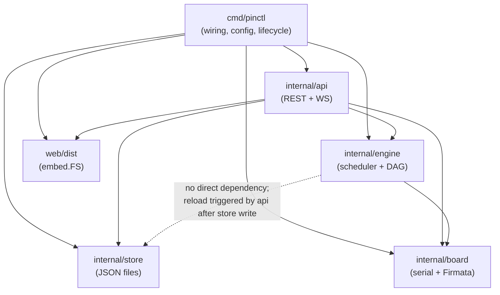
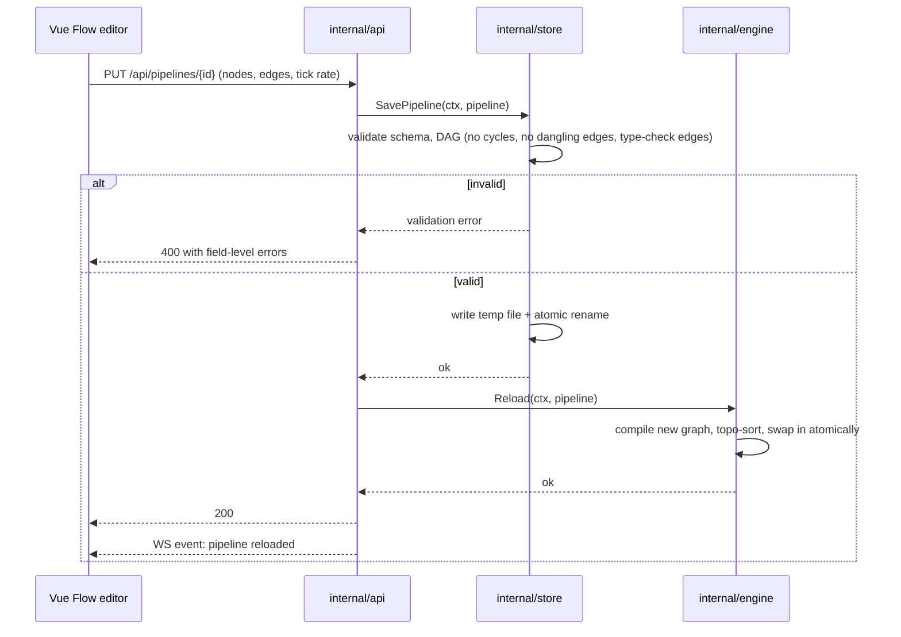
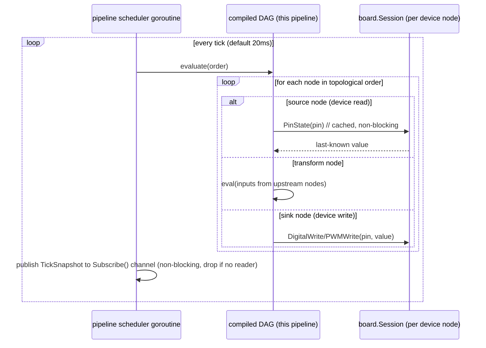
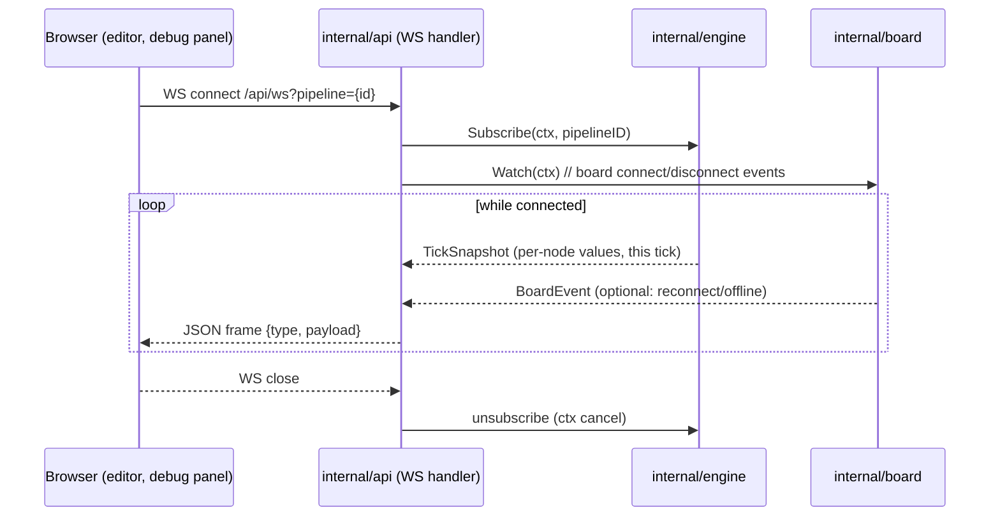
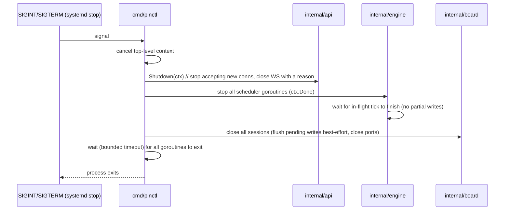

# pinctl — System Architecture

This document describes the full system architecture of pinctl: how the pieces fit
together, how data flows through the system, the concurrency model, failure handling,
and the key architectural decisions behind the design. It follows the decisions fixed
in [00-design-brief.md](./00-design-brief.md); if anything here appears to contradict
that file, the brief wins.

Related docs: [01-overview.md](./01-overview.md) (product framing),
[05-serial-protocol.md](./05-serial-protocol.md) (Firmata wire details),
[07-pipeline-engine.md](./07-pipeline-engine.md) (node catalog, DAG evaluation semantics),
[10-api.md](./10-api.md) (REST/WebSocket contract).

## Table of contents

- [System context](#system-context)
- [Component breakdown](#component-breakdown)
- [Data flow walkthroughs](#data-flow-walkthroughs)
- [Concurrency model](#concurrency-model)
- [Failure modes & handling](#failure-modes--handling)
- [Startup sequence](#startup-sequence)
- [Shutdown sequence](#shutdown-sequence)
- [Architectural decisions (ADR-style)](#architectural-decisions-adr-style)

## System context

pinctl is a single Go binary running on a Raspberry Pi. It embeds the built Vue 3 UI,
talks to one or more Arduino boards over USB serial using Firmata, and is the only
process a user interacts with — there is no cloud component and no external database.

```mermaid
flowchart LR
    subgraph Client["Browser (any device on the LAN)"]
        UI["Vue 3 SPA<br/>(Vue Flow editor, Pinia store)"]
    end

    subgraph Pi["Raspberry Pi — pinctl runtime (single Go binary)"]
        API["internal/api<br/>REST + WebSocket"]
        ENGINE["internal/engine<br/>pipeline scheduler + DAG evaluation"]
        BOARD["internal/board<br/>serial + Firmata session mgmt"]
        STORE["internal/store<br/>JSON files"]
        WEB["web/dist<br/>embed.FS"]
    end

    subgraph Serial["USB CDC serial, 57600 baud"]
        S1["/dev/ttyACM0"]
        S2["/dev/ttyACM1"]
    end

    subgraph MCU["Arduino Uno/Nano — StandardFirmata (never reflashed)"]
        A1["Board 1"]
        A2["Board 2 (optional)"]
    end

    subgraph Phys["Physical devices"]
        D1["LED / relay / PWM actuator"]
        D2["Sensor (digital/analog)"]
    end

    UI <-->|HTTP GET (static)| WEB
    UI <-->|"REST: CRUD pipelines/devices"| API
    UI <-->|"WS: live pin values, pipeline state, debug"| API

    API --> ENGINE
    API --> STORE
    ENGINE --> STORE
    ENGINE <--> BOARD

    BOARD <--> S1
    BOARD <--> S2
    S1 <--> A1
    S2 <--> A2

    A1 <--> D1
    A2 <--> D2
```

Everything to the right of the Pi is untrusted/unreliable hardware (boards get
unplugged, cables fail); everything to the left is a browser on the LAN with no auth
in the MVP. The Go binary is the single point of coordination between them.

## Component breakdown

The repository layout is fixed by the design brief:

```
pinctl/
  cmd/pinctl/          # main
  internal/board/      # serial + firmata session mgmt
  internal/engine/     # pipeline engine (graph, nodes, scheduler)
  internal/store/      # JSON file persistence
  internal/api/        # REST + WS handlers
  web/                 # Vue 3 app (built dist embedded)
```

### cmd/pinctl

Responsibility: process entry point only — no business logic.

- Loads `/etc/pinctl/config.yaml` (port, data dir, serial allowlist).
- Constructs `store.Store`, `board.Manager`, `engine.Engine`, `api.Server` and wires
  them together (dependency injection by hand, no DI framework).
- Owns the top-level `context.Context` and `os/signal` handling for graceful
  shutdown (see [Shutdown sequence](#shutdown-sequence)).
- Registers the `web/dist` `embed.FS` with the API server as the static file handler.

### internal/board

Responsibility: own the physical connection to each microcontroller. Nothing above
this package should touch a serial port directly.

```go
// Manager owns the lifecycle of all board sessions: discovery, connect,
// reconnect-with-backoff, and hands out safe accessors to callers (the engine).
type Manager interface {
    // Boards returns the current known boards and their status.
    Boards() []BoardInfo

    // Session returns the live session for a board, or ErrBoardOffline if the
    // board is currently disconnected/reconnecting.
    Session(boardID string) (Session, error)

    // Watch streams board connect/disconnect/error events (for the API layer
    // to relay over WebSocket).
    Watch(ctx context.Context) <-chan BoardEvent
}

// Session is a single connected board: one goroutine owns the serial port and
// the Firmata protocol state machine; Session is the safe façade over it.
type Session interface {
    BoardID() string
    Capabilities() PinCapabilities

    // DigitalWrite/PWMWrite/etc. queue a write to the board's serial goroutine
    // and return once acknowledged or on ctx cancellation.
    DigitalWrite(ctx context.Context, pin int, high bool) error
    PWMWrite(ctx context.Context, pin int, value uint8) error

    // PinState returns the last-known cached value for a pin (digital or
    // analog), updated asynchronously as Firmata reports arrive. Never blocks
    // on the serial port.
    PinState(pin int) (PinValue, bool)
}
```

- Uses `go.bug.st/serial` to open the port and a StandardFirmata client
  underneath (see [05-serial-protocol.md](./05-serial-protocol.md)).
- Each `Session` runs exactly one goroutine that owns the port; all reads/writes
  to it go through channels (see [Concurrency model](#concurrency-model)).
- Maintains the reconnect-with-backoff loop per board (see
  [Failure modes](#failure-modes--handling)).

### internal/engine

Responsibility: evaluate user-defined pipelines against board pin state on a fixed
tick, independent per pipeline.

```go
// Engine owns all loaded pipelines and their schedulers.
type Engine interface {
    // Load (re)installs the full pipeline set, e.g. at startup or hot-reload
    // after a store change. Replaces any pipeline with the same ID.
    Load(ctx context.Context, pipelines []model.Pipeline) error

    // Reload hot-swaps a single pipeline without stopping others.
    Reload(ctx context.Context, p model.Pipeline) error

    // Enable/Disable start or stop a pipeline's scheduler goroutine.
    Enable(ctx context.Context, pipelineID string) error
    Disable(ctx context.Context, pipelineID string) error

    // Status reports current state for the UI/API (running, tick count, last
    // error, per-node last value) — read from an atomically-swapped snapshot.
    Status(pipelineID string) (PipelineStatus, error)

    // Subscribe streams per-tick node value snapshots for live monitoring.
    Subscribe(ctx context.Context, pipelineID string) (<-chan TickSnapshot, error)
}

// graph is the internal compiled DAG for one pipeline: topologically sorted
// nodes + edges, built once on Load/Reload and treated as immutable thereafter.
type graph struct {
    nodes []node
    order []int // topological order, precomputed
}

// node is the unit of evaluation. Concrete node types (device read/write,
// constant, compare, threshold+hysteresis, scale, boolean ops, delay,
// debounce, edge-detect, log, timer) are documented in
// docs/07-pipeline-engine.md.
type node interface {
    eval(in []Value, st *nodeState) (out Value)
}
```

- One scheduler goroutine per **enabled** pipeline, ticking at that pipeline's
  configured rate (default 20 ms).
- Depends on `board.Manager` (via `Session.PinState`/`Session.DigitalWrite`/
  `PWMWrite`) for I/O, and on `store.Store` only indirectly — the engine never
  writes to disk; `cmd/pinctl`/`internal/api` own persistence and call
  `Engine.Reload` after a successful `Store` write.

### internal/store

Responsibility: durable persistence of devices and pipelines as JSON files under
`/var/lib/pinctl/` (dev default: `~/.pinctl/`). No database in MVP.

```go
// Store is the single source of truth for pipeline/device definitions.
// Implementations must make writes atomic (temp file + rename) so a crash
// mid-write never corrupts state on disk.
type Store interface {
    ListDevices(ctx context.Context) ([]model.Device, error)
    SaveDevice(ctx context.Context, d model.Device) error
    DeleteDevice(ctx context.Context, id string) error

    ListPipelines(ctx context.Context) ([]model.Pipeline, error)
    GetPipeline(ctx context.Context, id string) (model.Pipeline, error)

    // SavePipeline validates and persists a pipeline definition. Returns a
    // validation error (never partially written) if the graph is malformed
    // (see docs/07-pipeline-engine.md for validation rules: dangling edges,
    // cycles, type mismatches).
    SavePipeline(ctx context.Context, p model.Pipeline) error
    DeletePipeline(ctx context.Context, id string) error
}
```

- One JSON file per device/pipeline (or one file per collection — an
  implementation detail internal to `store`; either way, writes are atomic).
- Owns validation of the pipeline JSON schema before it ever reaches the engine;
  the engine assumes anything it receives via `Load`/`Reload` is already valid.

### internal/api

Responsibility: the only package that talks to the browser. Translates HTTP/WS
requests into calls against `store.Store` and `engine.Engine`, and relays engine/
board events out over WebSocket.

- REST (JSON): CRUD for devices and pipelines, enable/disable pipeline.
- WebSocket: live pin values (from `board.Manager.Watch` / `Session.PinState`
  polling), pipeline tick snapshots (from `Engine.Subscribe`), and editor debug
  streams.
- Serves the embedded `web/dist` `embed.FS` for all non-API routes (SPA fallback
  to `index.html`).
- No auth in MVP (LAN tool, per brief); a token/password check would slot in
  here as middleware in a later version without touching other packages.

### web/ (Vue 3 UI)

Vue 3 + Vite + Pinia + Vue Flow, built to static assets and embedded into the Go
binary via `embed.FS` at build time — one deployable artifact, no separate web
server. Talks exclusively to `internal/api` (REST for CRUD, WebSocket for live
data); it never has any other integration point into the runtime.

### Component dependency diagram



Notes on the dependency direction:

- `engine` depends on `board`, never the reverse — board sessions know nothing
  about pipelines.
- `engine` does not depend on `store`. Persistence and reload are orchestrated
  by `internal/api` (or `cmd/pinctl` at startup), keeping the engine a pure
  in-memory evaluator over whatever it was last told to `Load`.
- `web` only ever talks to `api`; it has no visibility into `engine`, `board`,
  or `store`.

## Data flow walkthroughs

### (a) Editor saves a pipeline → validation → store → engine hot-reload



Key point: validation happens once, in `store`, before anything is written to
disk or handed to the engine. The engine trusts its input completely — it never
re-validates a graph it's given.

### (b) Tick execution



Key point: `PinState` reads a value cached by the board's own read goroutine —
the engine tick never blocks on the serial port. Writes are queued to the
board session and are fire-and-forget from the tick's perspective (bounded by a
short ack timeout); a slow/stuck board degrades that one pipeline's writes, not
the tick rate of others.

### (c) Live monitoring via WebSocket



Each WebSocket connection gets its own subscriber channel; a slow UI client is
never allowed to block tick execution — the engine drops snapshots for a
subscriber that isn't keeping up rather than blocking the scheduler goroutine.

## Concurrency model

| Concern | Model | Why |
|---|---|---|
| One board serial session | 1 goroutine owns the port exclusively; all I/O in/out via buffered channels (`writeCh`, internal `readLoop`) | `go.bug.st/serial` file handles are not meant to be shared across goroutines; channels give a natural mailbox and back-pressure point |
| Cached pin state | Written only by the session's own goroutine; read via a `sync/atomic`-swapped snapshot (or `sync.RWMutex`-guarded map) exposed through `Session.PinState` | Readers (many engine ticks across pipelines) must never block or be blocked by the serial read loop |
| One pipeline scheduler | 1 goroutine per **enabled** pipeline, driven by `time.Ticker` at the pipeline's tick rate | Isolates a slow/misbehaving pipeline from every other pipeline; matches the tick-based engine decision below |
| Engine graph swap (Reload) | New `*graph` built off the hot path, then published via `atomic.Pointer[graph]` (or equivalent single-writer/many-reader swap) | Reload from the API goroutine must never race with, or stall, the ticking scheduler goroutine reading the current graph |
| Engine status/snapshot fan-out | Buffered channel per `Subscribe` caller; non-blocking send (drop-oldest or drop-newest on full) | WS clients are slow, untrusted consumers; must not apply back-pressure to the tick loop |
| Board manager registry | `sync.RWMutex`-guarded map of `boardID -> *session` | Low-frequency writes (connect/disconnect), frequent reads (`Session(boardID)`); a mutex is simpler and cheap enough here — this is not a hot loop |
| Shutdown coordination | Single top-level `context.Context` cancelled on signal; every goroutine (session, scheduler, WS handler) selects on `ctx.Done()` | One cancellation source, no ad-hoc stop channels to keep in sync |

General rule of thumb applied throughout: **channels for handing values across
a goroutine boundary that has its own control loop** (serial I/O, tick
scheduling, event fan-out); **mutexes/atomics for small, shared, low-churn
state** that many goroutines need to glance at without a rendezvous (pin state
cache, board registry, the current compiled graph pointer).

## Failure modes & handling

### Board unplugged / serial error

- The session's read loop detects an I/O error (or a heartbeat/poll timeout)
  and transitions the board to `offline`.
- `board.Manager` starts a reconnect loop with exponential backoff (e.g. 500ms →
  1s → 2s → ... capped, matching the serial allowlist in
  `/etc/pinctl/config.yaml` so it only ever retries known ports).
  Backoff resets on a successful reconnect.
  See [05-serial-protocol.md](./05-serial-protocol.md) for the Firmata
  handshake replay performed on reconnect.
- Any pipeline whose device nodes resolve to that board's pins is **paused**,
  not deleted or errored permanently: `Session.PinState`/writes return
  `ErrBoardOffline`, the pipeline's `TickSnapshot` marks the affected nodes as
  stale, and the API surfaces a `board offline` status to the UI. Other
  pipelines (on other boards) are unaffected — this is exactly what the
  per-pipeline scheduler goroutine isolation buys us.
- On reconnect, the board manager broadcasts a `BoardEvent{Connected}`, the
  affected pipelines resume writing/reading on their next tick automatically —
  no manual re-enable needed, since "paused" here means "reads return stale/
  writes no-op," not "scheduler stopped."

### Board reboots mid-session

- A board can reset (brownout, another process toggling DTR, the physical
  reset button) without the serial fd ever erroring — the transport is fine,
  but the MCU has forgotten every pin mode, reporting subscription, and
  sampling interval it had. `Session.Alive()` stays `true`; the "board
  unplugged" path above never triggers.
- Detected instead via the unsolicited protocol version report
  StandardFirmata re-emits on boot: `Session` treats one arriving after its
  own handshake completed as a reboot signal (see
  [05-serial-protocol.md, Mid-session board reset](./05-serial-protocol.md#mid-session-board-reset)
  for the wire-level detail).
- `Session` re-arms the sampling interval itself, then invokes a
  caller-registered callback (`Session.SetOnReboot`) asynchronously, off the
  read loop, so the callback is free to call back into the session (e.g.
  `SetPinMode`) without deadlocking it. `board.Manager` wires this callback
  to re-run the same `OnReady` reconfiguration (pin modes, onDisconnect safe
  values) a fresh connect gets — the board stays `connected` throughout,
  since the transport never dropped.

### Malformed pipeline

- Caught in `internal/store` at `SavePipeline` time (schema validation, cycle
  detection, edge type-checking) — never reaches the engine. The API returns
  `400` with field-level errors for the editor to highlight.
- A pipeline that somehow becomes malformed only after being loaded (e.g. a
  device it references was deleted) fails at `Engine.Reload`/`Load` time; the
  engine keeps the previous good graph running (if any) and reports the error
  via `Status`, rather than tearing down a working pipeline for a bad edit.

### Runtime restart

- On startup, `cmd/pinctl` calls `store.ListDevices`/`ListPipelines` and
  `engine.Load` with everything found on disk — this is the only source of
  truth for state after a restart (no in-memory-only state survives).
- Pipelines that were enabled before the restart are re-enabled automatically
  (enabled/disabled is itself part of the persisted `model.Pipeline`, not
  transient state) — see the design brief's domain model
  ("enabled/disabled... owns a tick rate").
  Boards reconnect independently via the normal connect flow; if a board isn't
  present yet, its pipelines simply start "paused" until it appears, same as
  the unplug case above.

## Startup sequence

```mermaid
sequenceDiagram
    participant Main as cmd/pinctl
    participant Cfg as config.yaml
    participant Store as internal/store
    participant BoardMgr as internal/board
    participant Engine as internal/engine
    participant API as internal/api

    Main->>Cfg: load /etc/pinctl/config.yaml
    Main->>Store: open data dir (/var/lib/pinctl or ~/.pinctl)
    Main->>BoardMgr: New(config.serialAllowlist)
    BoardMgr->>BoardMgr: attempt connect to each allowlisted port (async)
    Main->>Store: ListDevices(), ListPipelines()
    Main->>Engine: New(boardMgr)
    Main->>Engine: Load(ctx, pipelines)
    Engine->>Engine: compile graphs; start scheduler goroutine per enabled pipeline
    Main->>API: New(store, engine, boardMgr, web.dist)
    Main->>API: ListenAndServe(config.port)
    Note over BoardMgr: boards not yet connected keep retrying;<br/>their pipelines run "paused" until online
```

Startup never blocks on a board being present — the binary comes up and serves
the UI/API immediately, with boards and their pipelines catching up
asynchronously as connections succeed.

## Shutdown sequence



Nothing needs to be flushed to `internal/store` on shutdown — every save is
already durable (atomic write) at the time the API call returned success, so
shutdown is purely about stopping goroutines cleanly, not persisting state.

## Architectural decisions (ADR-style)

### ADR-1: Tick-based engine, not event-driven

- **Decision**: The pipeline engine evaluates each enabled pipeline's DAG on a
  fixed tick (default 20 ms), reading cached pin state and writing outputs
  every tick, rather than reacting to individual pin-change events.
- **Context**: Firmata reports analog/digital changes asynchronously; an
  event-driven engine could in principle react only when something changes,
  which sounds more efficient.
- **Consequences**: Tick-based evaluation is far easier to reason about,
  debug, and test deterministically (a `TickSnapshot` is a full, reproducible
  picture of the system at time T); it naturally isolates pipelines from each
  other (one goroutine, one ticker each) and avoids a whole class of ordering
  bugs an event-driven dataflow graph would introduce (what order do
  simultaneous events on different edges get processed in?). The cost is a
  fixed floor on latency/CPU (a paused/idle pipeline still ticks) and no
  realtime guarantees below the tick rate — both explicitly accepted as
  non-goals in the design brief. See
  [07-pipeline-engine.md](./07-pipeline-engine.md) for the exact evaluation
  order and per-node semantics.

### ADR-2: StandardFirmata, not a custom `pinctl-agent` protocol

- **Decision**: MVP boards run stock StandardFirmata; pinctl only speaks the
  existing Firmata protocol over serial.
- **Context**: A custom protocol could expose richer capabilities (e.g. bulk
  reads, board-side debouncing) tailored to pinctl's needs.
- **Consequences**: Zero firmware development or flashing tooling needed for
  MVP; existing Go Firmata clients de-risk the serial layer entirely. The
  trade-off is being bound to whatever StandardFirmata supports (its message
  set, its default sampling behavior) and to its baud rate (57600). A custom
  `pinctl-agent` protocol is documented as a v2 option, gated on actually
  hitting a Firmata limitation in practice — not built speculatively. See
  [05-serial-protocol.md](./05-serial-protocol.md).

### ADR-3: JSON files, not a database

- **Decision**: Devices and pipelines persist as JSON files under
  `/var/lib/pinctl/` (or `~/.pinctl/` in dev), written atomically (temp file +
  rename). No SQLite/Postgres/etc. in MVP.
- **Context**: A database would give transactions, indices, and a natural home
  for future history/metrics data.
- **Consequences**: Zero migrations, zero schema tooling, human-readable and
  git-diffable config, trivial backup (copy a directory). Costs: no query
  capability beyond "list everything," and every read/write is a full
  file — acceptable given expected data volumes (tens of devices/pipelines,
  not thousands). SQLite is the documented upgrade path if/when
  history or metrics land on the roadmap, at which point it would likely sit
  alongside — not replace — the JSON files for config.

### ADR-4: Embedded UI (`embed.FS`), not a separately served frontend

- **Decision**: The Vue 3 build output is embedded into the Go binary via
  `embed.FS` and served by `internal/api`; there is no separate web server or
  static file host to run.
- **Context**: Vue 3 + Vite produces static assets that could instead be served
  by nginx/Caddy, a CDN, or a Node server alongside the Go binary.
- **Consequences**: One deployable artifact, one systemd unit, one port — the
  simplest possible operational story for a Raspberry Pi LAN tool, matching
  the brief's "single Go binary... no external services." The cost is a
  rebuild-and-redeploy of the whole binary for any UI-only change (no
  independent frontend deploy), which is an acceptable trade-off at this
  project's scale and deployment model.
